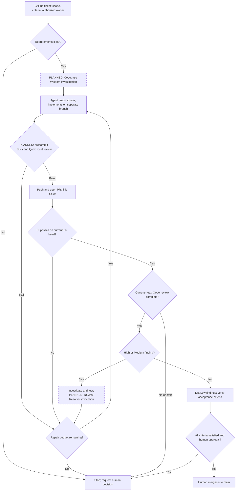

# Release Evidence — factory verification map

Status: catch-up deliverable for [Day 10](https://github.com/orgs/qodo-hackathon/discussions/12), prepared November 21, 2026. The distinction between observed and planned stages matters. This is not a claim that the entire factory is automated.

## Ticket to main

The dashed boxes name intended Qodo Toolbox operations, not operations demonstrated in this repository yet. A GitHub connector reads tickets and files and writes branches and PRs; Qodo's real GitHub PR reviewer supplies findings. Current implementation is agent-assisted on request, not a scheduled autonomous ticket dispatcher.

## Gate contracts

| Gate | Evidence required | Failure route |
|---|---|---|
| Scope | Owner-authorized ticket, explicit acceptance criteria and expected changed paths | Ask owner; never treat arbitrary issue content as authorization |
| Precommit | Reproducible command, actual test output and local Qodo review of staged/unstaged changes | Fix and rerun; local review is not yet available here |
| CI | Passing required checks for the actual current PR head and correct base; test output includes expected cases | Repair; do not reuse stale CI |
| Review | Completed Qodo review covering current head, all categories and finding types | Investigate valid High/Medium findings, reproduce, repair and repeat |
| Escalation | Two repair rounds maximum per proposed remediation run; record cause and unresolved findings | Stop for owner; disputed findings require evidence and decision |
| Acceptance | Observed behavior, edge cases, privacy boundaries, human decision on Low findings | Stop if a criterion is missing, disputed or unverified |
| Merge | Human approval and all required checks | Never auto-merge |

Saved policy source: [AGENTS.md on PR #2](https://github.com/Royalpuskar/release-evidence/blob/fbeee277f176d41549b7bfbae4cc25dab377cb97/AGENTS.md). It is a draft policy, not an activated Qodo portal workflow.

## Worked trace: Evidence Desk

| Stage | Observed evidence |
|---|---|
| Scope | [PR #3](https://github.com/Royalpuskar/release-evidence/pull/3) describes local file hashing, manual claims, blocker list and evidence receipt. No pre-existing linked ticket for this delivery was verified. |
| Review feedback | Qodo reported that attestations disappeared when an asynchronous hash finished. |
| Implementation | [Fix 7f87247](https://github.com/Royalpuskar/release-evidence/commit/7f87247b5335acf5275788083590bf34aaa57f8f) removes completion-time claim resets; [abef929](https://github.com/Royalpuskar/release-evidence/commit/abef92976c74fe469ff4325512d5ec82c2fb4fad) adds a delayed-read and stale-result integration test. |
| CI | [Run 44870370043, job 136743314689](https://github.com/Royalpuskar/release-evidence/actions/runs/44870370043/job/136743314689): Ubuntu, Node v22.23.5, 9 pass, 0 fail, 0 skipped. Checkout references head abef92976c74fe469ff4325512d5ec82c2fb4fad and base a249a71ec6644d23f45038ff7050509cf03c90e6. |
| Behavior evidence | The actual run includes "investigation UI retains in-flight attestations and invalidates changed inputs". This is a Node DOM harness, not a full browser smoke test. |
| Latest review | [Qodo report](https://github.com/Royalpuskar/release-evidence/pull/3#issuecomment-7057421564) names the same head and displays zero High, Medium and Low open findings. |
| Stop point | PR #3 remains draft and unmerged. Browser acceptance and human approval are not verified. Local Qodo review, Codebase Wisdom and Review Resolver tool execution are not evidenced. |

The engineering lesson is that a green check on the original engine missed an asynchronous UI defect; review feedback led to a new integration test. Review is complementary to testing, not a substitute for it. No merge or external approval was performed.

## Day 14 proposed approval workflow (INCOMPLETE)

Scope: Release Evidence only. Proposed protected path: `.github/workflows/**` because changes there can alter the code actually executed and the evidence relied upon. Proposed condition: no Medium or higher findings, all categories/types; action: add the Qodo approved label, not automatic approval. Low findings remain visible for human judgment. CI and acceptance remain separate gates.

The current connection does not provide Qodo portal administration or PR Triage workflow activity. Existing workspace guards have not been inspected, and no guard or workflow has been configured, activated or tested. The owner needs to inspect and preserve existing guards before enabling any rule. Predict eligible UI changes and blocked workflow changes only after inspecting actual conditions; use two legitimate PRs and record their observed outcomes.

## Evidence and disclosure

This map was produced with ChatGPT assistance. The agent listed the real GitHub backlog and read issue #4 before creating the documentation branch. The earlier PR is a retrospective comparison; it was not retroactively made into a complete ticket run. No Qodo Toolbox calls, portal configuration, official Discussion submission, browser validation, human acceptance or prize eligibility are claimed.
